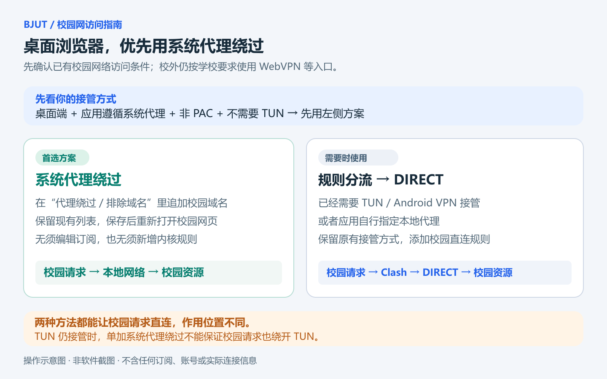
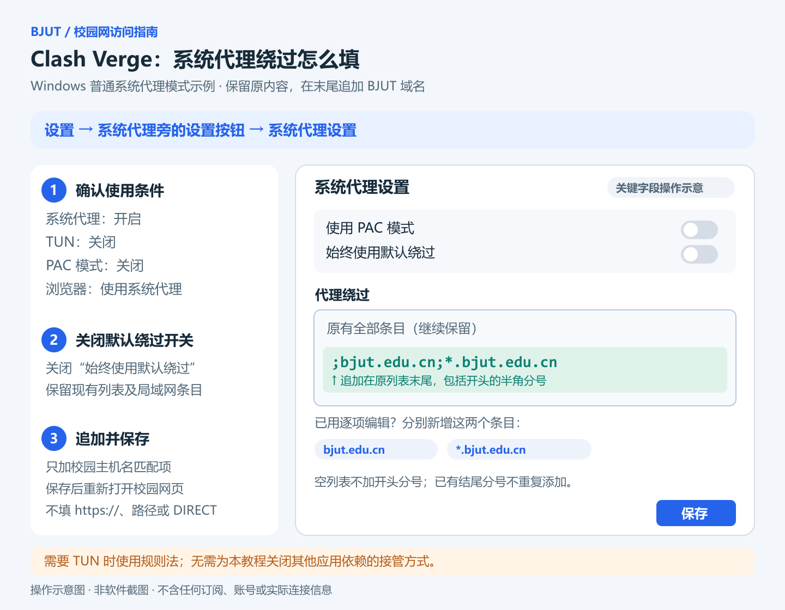

# Clash Verge Rev：BJUT 校园域名直连

[返回首页](../README.md)

## 选系统绕过还是规则？

**桌面浏览器和遵循系统代理的应用，不需要 TUN 时优先用系统代理绕过。** 本方法使用系统代理开启、TUN 关闭、非 PAC 的普通模式。下面以 Windows 的文本列表为例；已经依赖 TUN 的用户直接用 B 节。

- 已经使用 TUN，或应用手动指向本地代理：转到 B 节，用规则分流。
- macOS / Linux 遵循系统代理的应用：同样可优先配置系统代理例外，按该系统/客户端的主机列表界面填写，分隔符和匹配格式以界面为准。
- PAC 模式有自己的判断脚本，按[官方 PAC 示例](https://www.clashverge.dev/guide/bypass.html)修改，或用规则分流处理进入内核的请求。



## A. 首选：Windows 系统代理绕过

1. 确认系统代理开启、TUN 关闭；在“设置”中打开“系统代理设置”，确认使用默认模式（非 PAC）。
2. 复制保存当前“代理绕过”的全部内容。
3. 关闭“始终使用默认绕过”，保留文本框内已有条目。
4. 在文本末尾追加：

   ```text
   ;bjut.edu.cn;*.bjut.edu.cn
   ```

5. 保存。若使用逐项编辑界面，分别新增两个条目即可。
6. 确认 TUN 关闭，浏览器没有被插件切到其他固定代理；重新打开校园网页。



追加前后示例（`localhost;127.*;10.*` 只是便于说明的短示例，不是完整默认列表）：

```text
修改前：localhost;127.*;10.*
修改后：localhost;127.*;10.*;bjut.edu.cn;*.bjut.edu.cn
```

现有内容已包含 `*.cn` 时，学校子域名已经被覆盖；无需再重复追加。为了说明校园域名范围，首页仍展示单独添加学校域名的做法。

**空文本框不加开头分号；已有结尾分号不再重复。** `https://my.bjut.edu.cn/xxx` 应只提取主机名 `my.bjut.edu.cn`。填写 `*.bjut.edu.cn` 可覆盖其多个子域名，另保留 `bjut.edu.cn` 以明确覆盖根域名。

系统绕过配置保存在客户端设置中，不属于远程订阅原文。正常刷新订阅会保留；重置应用、恢复另一份备份或其他程序覆盖系统代理后，重新检查。

依据：[官方绕过文档](https://www.clashverge.dev/guide/bypass.html)、[设置界面及平台分隔符实现](https://github.com/clash-verge-rev/clash-verge-rev/blob/dev/src/components/setting/mods/sysproxy-viewer.tsx)。源码链接跟随开发分支变化，菜单以安装版本为准。

## B. TUN、手动代理等情况：规则分流

本节适用于已被 TUN 接管、应用手动指向本地代理，或需要通过内核规则管理的请求。保持原有接管方式，只增加校园直连规则。

1. 选择 **规则 / Rule** 出站模式。
2. 到“订阅”，在正在使用的卡片上右键 → **编辑规则**。
3. 在 **前置规则 / Prepend** 添加：

   ```text
   类型：DOMAIN-SUFFIX
   内容：bjut.edu.cn
   策略：DIRECT
   ```

4. 保存并检查配置是否应用成功。重新访问目标页面，在“连接”中搜索 `bjut.edu.cn`，核对实际主机及出口。
5. 如有旧连接，先关闭相关网页/应用再重试；已有连接不会因为修改规则就一定立即重建。

**不要直接编辑下载的订阅 YAML 来代替本地“编辑规则”。** 远程订阅原文可能被下次更新替换。官方“编辑规则”保存的本地前置项会随该订阅继续应用；每份订阅分别检查。

前置规则通常优先于原订阅规则。若有其他扩展脚本再次重写 `rules`，应查看最终配置和连接结果；同一请求最终按实际生效顺序匹配。

依据：[官方图文操作](https://www.clashverge.dev/guide/rules.html)、[扩展配置执行顺序](https://www.clashverge.dev/guide/extend.html)。

## 需要校园 IP 规则时

如果实际访问的是 IP 字面地址，域名规则不会匹配该请求。应根据已知且有权访问的目标，在前置规则添加对应的 `IP-CIDR` 条目；不要根据“学校”二字猜网段。

本仓库的[通用规则页](common-rules.md)提供标准私有网段的可选片段。已有默认绕过或规则覆盖这些网段时，不必再加。

## 恢复

- 系统绕过：只移除本次添加的 `bjut.edu.cn` 与 `*.bjut.edu.cn`，或还原你事先保存的文本，再保存。
- 规则分流：从该订阅的前置规则中移除本次校园规则并保存。
- 如果修改过“始终使用默认绕过”开关，可按修改前状态恢复。不要清空整份列表或其他自定义规则。
