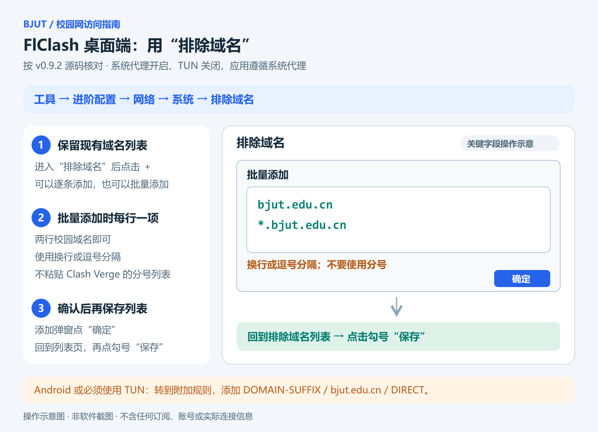

# FlClash：开着代理访问校园网站

[返回首页](../README.md)

核对版本：**FlClash v0.9.2**。以下菜单名称与生效条件按官方源码核对；设置后按最后一节检查实际连接。

目标是保留代理服务，让 `bjut.edu.cn` 及其子域名通过本地网络直连。对于校园内网资源，设备仍需处于可访问该资源的校园网环境，或已接入学校提供的远程访问服务。直连规则不能代替校园网接入权限。

## 首选：桌面端设置系统代理排除域名

适用于 Windows、macOS，以及支持系统代理设置的 Linux 桌面。浏览器或应用需要遵循系统代理设置，本方法要求 FlClash 的“虚拟网卡”（TUN）关闭。已经需要 TUN 的用户使用下一节规则法。Linux 的实际作用范围还取决于桌面环境和应用是否读取对应代理设置。

1. 在“仪表盘”保持 FlClash 运行，开启“系统代理”，关闭“虚拟网卡”。出站模式可保持“规则”。
2. 进入 **工具 → 进阶配置 → 网络**，在“系统”分组打开 **排除域名**。
3. **保留已有列表**，点击“＋”。可逐条添加下面两项；也可点击添加弹窗中的“批量添加”图标，粘贴下面两行：

   ```text
   bjut.edu.cn
   *.bjut.edu.cn
   ```

4. 点击添加弹窗的“确定”。回到“排除域名”列表后，再点击勾号 **保存**。仅关闭添加弹窗还没有保存整个列表。
5. 重新打开校园页面，必要时重启浏览器，让它读取新的系统代理设置。

**这里每行一项，批量添加也支持逗号；不要使用 Clash Verge 教程中的分号串。** 只填主机名或通配符，不填 `DIRECT`、`https://` 或网页路径。主域名和通配符各占一项，避免只覆盖子域名。



此列表属于 FlClash 本地设置，独立于订阅，普通订阅更新会保留；它不要求修改订阅的扩展模式。桌面端保存后会重新写入系统代理设置。[网络页面与平台分组](https://github.com/chen08209/FlClash/blob/v0.9.2/lib/views/config/network.dart)、[列表添加与保存](https://github.com/chen08209/FlClash/blob/v0.9.2/lib/widgets/edit_view.dart)

## 后备：TUN、Android 或不遵循系统代理的应用

需要使用虚拟网卡，或应用不读取系统代理时，使用内核规则分流。应用流量须先通过 TUN 或其自身代理设置进入 FlClash，规则才能生效。Android 通过 VPN 接管流量，采用本节规则法更合适；其设置中也有“排除域名”，但该项只针对系统代理路径，不能据此保证 VPN 接管的流量直连。

### 1. 选择规则模式并检查扩展

在“仪表盘”的“出站模式”中选择“规则”。保持已能正常工作的网络接管方式，启动 FlClash。这里的“规则”决定连接怎样分流；下面的“标准”决定怎样扩展订阅。

先检查已有扩展：**正在使用脚本扩展或自定义配置的用户，保留现有方式，将校园规则合并到原脚本或配置；不要直接切换，以免停用已有分流。** 可参考[通用规则](common-rules.md)。

普通订阅用户进入“配置”，打开当前订阅的“⋯”菜单，选择“扩展”，确认“扩展模式”为“标准”，再继续下文。如果本来已有标准扩展设置，保留原有条目。如出现“立即应用”，点击它；返回时也会检查并应用修改。

本文的全局附加规则只供使用标准扩展的 URL、文件配置加载；脚本扩展和自定义配置不使用这一列表。[官方扩展页面实现](https://github.com/chen08209/FlClash/blob/v0.9.2/lib/views/profiles/extend/extend.dart)

### 2. 添加校园直连规则

打开 **工具 → 进阶配置 → 附加规则**，点击“＋”，填写：

| 字段 | 填写内容 |
|---|---|
| 代理类型 | `DOMAIN-SUFFIX` |
| 内容 | `bjut.edu.cn` |
| 分流策略 | `DIRECT` |

点击“保存”。“内容”栏只填域名，不加 `https://`、`*.`、分号或页面路径。这条规则会匹配学校主域名和子域名；不覆盖学校使用的其他独立域名。[官方规则表单](https://github.com/chen08209/FlClash/blob/v0.9.2/lib/features/form/rule.dart)

回到当前订阅的“扩展 → 标准”，进入“控制全局附加规则”，确认新规则开关开启。若同一网站仍被其他规则提前匹配，检查当前订阅自己的附加规则：它们排在全局附加规则前面。全局附加规则保存于本地数据库，普通订阅更新不会将其替换；删除应用数据则会丢失。新增订阅也要确认使用标准扩展，且没有禁用这条规则。[规则存储、筛选与顺序](https://github.com/chen08209/FlClash/blob/v0.9.2/lib/database/rules.dart)

## 重新发起请求并验证

先重新打开校园页面，再访问一个原本需要代理的网站，确认两者都能工作。若主页面成功、登录或资源加载失败，检查跳转域名和接口请求，按实际主机名补充。

使用**系统代理排除域名**时，符合条件的请求直接从应用发出，通常不会出现在 FlClash 连接列表中；列表里没记录本身不足以证明直连，可结合浏览器网络记录与系统代理设置确认。使用**规则分流**时，到“连接”或“最近请求”中查找域名，确认命中校园规则、出口为 `DIRECT`。附加规则变化会触发正在使用标准扩展的配置重新应用；若提示有未应用修改，先点击“立即应用”。

页面返回 `200` 只说明收到了成功状态的 HTTP 响应，不能单独证明直连或登录成功。两种方法都不改变设备对校园内网的原有访问权限。
